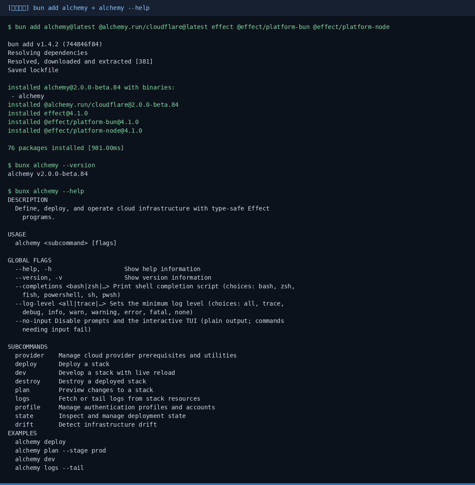
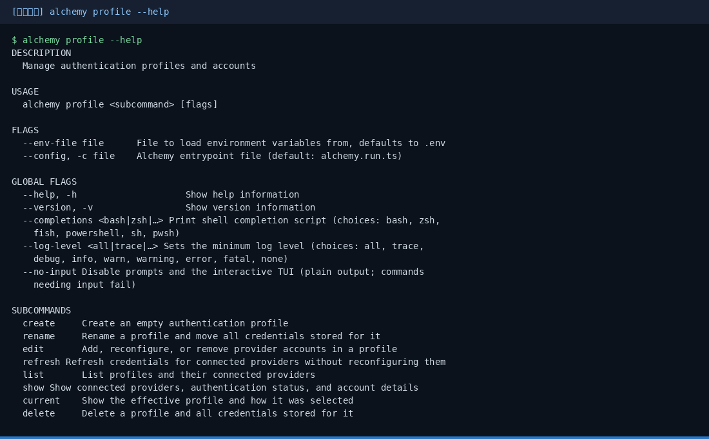
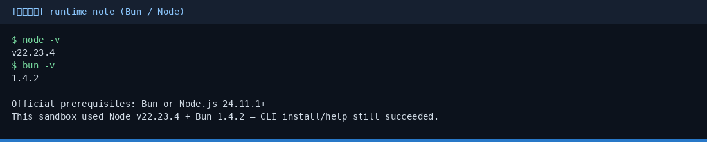
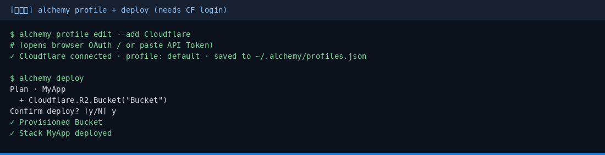

# Alchemy 小白中文教程

> Infrastructure-as-Effects 入门（社区非官方教程）  
> 上游：[`alchemy-run/alchemy`](https://github.com/alchemy-run/alchemy) · 官网：[alchemy.run](https://alchemy.run)  
> 教程校对日期：2026-10-29（Asia/Shanghai）· 本机实测 **alchemy v2.0.0-beta.84**（Bun 1.4.2）

[](https://github.com/xianyu110/awesome-alchemy-zh)
[](https://github.com/alchemy-run/alchemy)
[](LICENSE)
[](https://xianyu110.github.io/awesome-alchemy-zh/)

---

## 截图索引

| # | 文件 | 类型 | 说明 |
|---|------|------|------|
| 1 | [`images/01-install-help.png`](images/01-install-help.png) | **真实** | `bun add alchemy…` + `alchemy --version` / `--help` |
| 2 | [`images/02-profile-help.png`](images/02-profile-help.png) | **真实** | `alchemy profile --help`（CF 登录入口） |
| 3 | [`images/03-runtime.png`](images/03-runtime.png) | **真实** | 本机 Bun / Node 版本与官方前置对照 |
| 4 | [`images/04-deploy-schematic.png`](images/04-deploy-schematic.png) | **示意图** | `profile edit --add Cloudflare` + `deploy`（需 CF 登录，未实拍） |

> 真实截图在 Linux 沙盒采集；路径已脱敏。**alchemy v2 仍在 beta，可能有 breaking changes**——以官网为准。

---

## 这是什么？

**Alchemy**（alchemy-run）把云资源与应用逻辑写成**同一套 Effect / TypeScript 程序**（Infrastructure-as-Effects）：

- 一个 `alchemy.run.ts` Stack 里声明 Cloudflare / AWS 等资源
- 同一套代码覆盖本地 `dev`、`plan` / `deploy`、CI
- 用 `alchemy profile` 做 OAuth / API Token 登录，不必手写一堆环境变量
- 本教程以 **Cloudflare 入门**为主（官方 Getting Started 同路径）

本仓库只提供**中文小白教程**（MIT），不二次分发上游包。

---

## 官方链接（请以官方为准）

| 资源 | 链接 |
|------|------|
| 官网 | https://alchemy.run |
| Getting Started | https://alchemy.run/getting-started |
| Cloudflare 教程 | https://alchemy.run/cloudflare/tutorial/part-1 |
| 源码 | https://github.com/alchemy-run/alchemy |
| npm | https://www.npmjs.com/package/alchemy |
| llms.txt（给 Agent） | https://alchemy.run/llms.txt |

---

## 环境要求（摘要）

官方 Getting Started：

- **Bun** 或 **Node.js 24.11.1+**
- 一个 **Cloudflare** 账号（本教程入门路径）

本机沙盒实测：`Bun 1.4.2` + `alchemy@2.0.0-beta.84` 可完成依赖安装与 CLI `--help` / `--version`。若你仍用较旧 Node（如 22），请优先改用 Bun，或升级到官方要求的 Node 版本。

---

## 安装（macOS / Linux / Windows）

包管理器任选其一（摘自官方 README / Getting Started）：

```bash
# 推荐：Bun
bun add alchemy@latest @alchemy.run/cloudflare@latest effect @effect/platform-bun @effect/platform-node

# 或 pnpm / npm
pnpm add alchemy@latest @alchemy.run/cloudflare@latest effect @effect/platform-node
# npm install alchemy@latest @alchemy.run/cloudflare@latest effect @effect/platform-node
```

也可按官网「Create a project」脚手架创建（以当前文档标签页为准）。装好后：

```bash
bunx alchemy --version   # 或 npx alchemy --version
bunx alchemy --help
bunx alchemy profile --help
```

本机真实安装 + help：







---

## 第一次演示任务（约 10 分钟）

### 1. 写最小 Stack

在项目根创建 `alchemy.run.ts`（结构来自官方 Getting Started）：

```typescript
// alchemy.run.ts
import * as Alchemy from "alchemy";
import * as Cloudflare from "@alchemy.run/cloudflare";
import * as Effect from "effect/Effect";

export default Alchemy.Stack(
  "MyApp",
  {
    providers: Cloudflare.providers(),
    state: Cloudflare.state(),
  },
  Effect.gen(function* () {
    const bucket = yield* Cloudflare.R2.Bucket("Bucket");
    return { bucketName: bucket.bucketName };
  }),
);
```

### 2. 连接 Cloudflare

```bash
alchemy profile edit --add Cloudflare
# 浏览器 OAuth，或粘贴 API Token
# 凭据写入默认 profile（~/.alchemy/profiles.json）
```

### 3. 部署

```bash
alchemy plan      # 预览
alchemy deploy    # 确认后创建 R2 Bucket
```

> **示意图**（本教程沙盒无 Cloudflare 登录，未实拍 deploy）：



```text
$ alchemy profile edit --add Cloudflare
✓ Cloudflare connected · profile: default

$ alchemy deploy
Plan · MyApp
  + Cloudflare.R2.Bucket("Bucket")
✓ Stack MyApp deployed
```

完整 Cloudflare 应用请跟官方 [Tutorial Part 1](https://alchemy.run/cloudflare/tutorial/part-1)。

---

## 常见报错与处理

| 现象 | 可能原因 | 处理 |
|------|----------|------|
| `alchemy: command not found` | 未装到 PATH / 未用 npx·bunx | 用 `bunx alchemy` / `npx alchemy`，或全局安装后再开终端 |
| plan/deploy 依赖解析失败 | Node 过旧或 Effect 未装齐 | 改用 **Bun**，或 Node **24.11.1+**；按官方补齐 `effect` 与 `@effect/platform-*` |
| deploy 提示去跑 profile | 未登录 Cloudflare | `alchemy profile edit --add Cloudflare` |
| v2 beta 行为变了 | 上游仍在迭代 | 以 [alchemy.run](https://alchemy.run) 与 Release 为准；本教程日期见页眉 |
| 想换 Token / 多 profile | 多环境 | `alchemy profile edit --reconfigure Cloudflare` 或 `alchemy profile create prod` |

---

## 模型 / API 合规说明（国内读者）

- Alchemy 本身是**基础设施 / Effect 部署框架**，不内置「必须用」的境外大模型。
- 本教程**不硬推**未备案境外模型或 API 中转。若你在 Agent 辅助写 Stack 时需要 OpenAI 兼容接口，可自行评估本地 Ollama / 国内兼容端，或 [TryAllAPI](https://tryallapi.com/register?aff=5A6A)（轻提示，非必须）。
- 周边工具选购（可选）：[https://wzyp.cn/shop/maynorai](https://wzyp.cn/shop/maynorai)

---

## 许可证说明

| 内容 | 协议 |
|------|------|
| **本教程文案**（README / docs） | [MIT](LICENSE) |
| **Alchemy 上游** | [Apache License 2.0](https://github.com/alchemy-run/alchemy/blob/main/LICENSE) |

与 alchemy-run **无官方隶属关系**，仅为社区中文导读。

---

## 维护

- 作者：Maynor（[@xianyu110](https://github.com/xianyu110) / Maynor996）
- 上游问题：https://github.com/alchemy-run/alchemy/issues
- 在线页：https://xianyu110.github.io/awesome-alchemy-zh/
